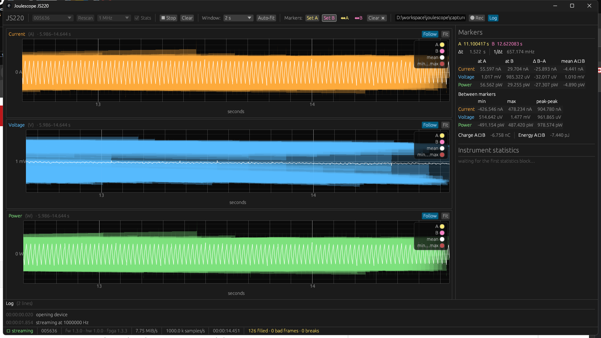

# joulescope-rs

A Rust host driver and command line tool for the
[Joulescope JS220](https://www.joulescope.com/) precision energy analyzer.

The official stack is a C driver (`joulescope_driver`) with Python bindings and
a Qt UI. This is an independent implementation of the same USB protocol in
Rust, built around a deeper bulk transfer queue and an allocation-free receive
path.

```
crates/
  js220-proto   wire protocol codec — no I/O, no threads, no device handles
  js220         USB transport and device session
  jsctl         command line tool
  jsgui         live GUI: plots, markers, measurements, recording
```



## Status

Working and verified on hardware. Streams at the full 1 Msps on current and
voltage simultaneously — **7.75 MiB/s sustained, 100% of the requested rate** —
and captures to disk at every supported rate from 1 kHz to 1 Msps.

## Build

Needs a Rust toolchain and a linker. Nothing else; there are no C dependencies,
so no libusb, no CMake, no vendored submodules.

```bash
cargo build --release
```

The binary lands at `target/release/jsctl`.

## Use

```bash
# What is attached?
jsctl list

# Versions, settings, and the transfer queue in effect
jsctl info

# Live statistics, computed on the instrument
jsctl stats --stats-rate 2

# Stream current, voltage and power to a file for 10 seconds
jsctl capture -o run.f32 --rate 1000000 --signals i,v,p --duration 10

# Same, as CSV
jsctl capture -o run.csv --format csv --rate 1000 --duration 10

# How fast does this host actually sustain?
jsctl bench --duration 10
```

### Capture formats

`--format bin` (the default) writes little-endian `f32`, columns interleaved in
the order given to `--signals`, with no header. A three-signal capture at
1 Msps is 12 MB/s. Read it back with anything that can read raw floats:

```python
import numpy as np
rows = np.fromfile("run.f32", dtype="<f4").reshape(-1, 3)
current, voltage, power = rows[:, 0], rows[:, 1], rows[:, 2]
```

`--format csv` writes a header plus `sample_id`, `time_s` and one column per
signal. It is far slower and much larger; use it for small captures and quick
inspection.

## The GUI

```bash
jsgui           # pick a device and press Start
jsgui --start   # begin streaming immediately
```


**Resolution follows the view.** Recent samples are retained raw and aggregated
to whatever range is on screen, so zooming in reveals the real waveform down to
individual samples. Aggregating once at capture time would be cheaper, but the
detail would be gone for good and a 1 Msps signal would read as a solid block
at every zoom. The badge on each plot says what you are looking at: `raw`, or
how many samples each column covers, or `history` once you pan beyond the raw
window into the coarse buffer.

Each column is stroked from its minimum to its maximum, so a single-sample
spike stays visible however far out you are, with the mean drawn over the top.

**Two acquisition paths.** The rate list runs 1 kHz to 1 MHz for calibrated
amperes and volts, and ends with **2 MHz raw ADC**. The instrument caps
calibrated output at 1 Msps because its analog ports decimate the 2 MHz
counter by two; the raw ADC ports do not, so they reach the full rate. Raw
samples are uncalibrated counts with no gain, offset or range correction
applied, so the plots relabel to ADC 0 and ADC 1, power disappears — counts
cannot be multiplied into watts — and no integral is offered. It is for seeing
fast edges, not for measuring. `jsctl --source raw` does the same from the
command line.

**Scaling.** Both axes pan and zoom at any time, with the wheel zooming about
the pointer; shift restricts it to time and ctrl to the value axis. Each plot
has its own *Follow* (track the newest data) and *Auto Y* (scale to what is on
screen), kept independent so a Y zoom does not stop the trace tracking live
data and following live data does not stamp out a Y zoom. *Fit* turns both back
on. A view the data has scrolled past snaps back to the live edge rather than
stranding you on an empty plot.

**Markers.** `A|B` places a pair, `A` places one, `✖` clears them. They are
dragged directly in any plot and appear at the same instant in all of them;
dragging *between* a pair moves both rigidly, which is how a measurement window
is positioned once its width is right.
Each is labelled with the value underneath it, and the span's statistics are
drawn beside it inside the plot — avg, std, rms, min, max, p2p, and the time
integral where one is meaningful, so current integrates to charge and power to
energy but voltage gets none.

**Recording** writes the same interleaved little-endian `f32` format `jsctl`
produces, so the two are interchangeable.

The acquisition thread owns the device and never blocks on rendering: a host
that stops draining the bulk IN queue makes the *device* drop samples silently.

## Design

### Where the throughput comes from

The JS220 streams up to 1 Msps on current and voltage simultaneously, which is
roughly 8 MB/s of bulk IN traffic that must never stall. Three things matter:

**A deep, wide transfer queue.** The default is 8 bulk IN transfers of 128 KiB
each, one megabyte in flight. The device always has somewhere to put data, and
the host wakes roughly 60 times a second per queued transfer rather than
thousands. Both dimensions are tunable with `--transfer-size` and
`--queue-depth`, and `jsctl bench` will tell you what a given pairing achieves
on your machine.

**An allocation-free steady state.** A completed transfer is parsed in place —
frames are borrowed out of the USB buffer, never copied into intermediate
messages — and the buffer goes straight back into the queue. Decoded samples
land in reused per-signal buffers. After the first few seconds, streaming
performs no heap allocation at all.

**Decimation on the instrument.** Sample rates below 1 Msps are produced by the
JS220's own decimation filter, so the host never receives samples it would only
filter away. Running at 10 ksps moves a hundredth of the bytes rather than
moving them all and discarding 99%.

`jsctl capture` additionally runs formatting and disk I/O on a separate thread,
fed by a bounded queue with buffer recycling. If the writer falls behind, blocks
are dropped and **counted**, rather than back-pressuring the acquisition thread
into stalling the USB queue — a stalled queue makes the *device* drop data
silently, which is strictly worse than a host-side drop you can see in the
summary.

### Sample alignment

Current and voltage arrive on separate ports, in separate frames, with
independent sample ids and no guarantee of arriving together. The driver places
both on one timeline keyed by sample id and hands out only the span where every
requested signal is present.

Gaps are filled with `NaN` rather than closed up. This is deliberate: if a frame
is lost, row *N* must still be the same instant on every signal, or every
sample after the loss is silently misaligned against the others. A `NaN` is
visible; a quiet one-sample shift is not.

Power is computed on the host as `current × voltage` from the aligned pair, so
requesting power implicitly enables both. The instrument can emit power
directly at lower rates, but computing it keeps one code path for all rates and
costs a vectorized multiply.

### 128-bit statistics

The on-instrument statistics record accumulates sums, sums of squares and
running integrals in fixed point up to 128 bits wide. Rust has `i128` natively,
so variance and charge/energy integration are ordinary arithmetic; the
reference C driver carries a hand-written 128-bit module for the same job.
Variance is computed entirely in integers before a single conversion to `f64`,
so no precision is lost to intermediate rounding.

### Threading

`Js220` is deliberately single-threaded: one thread owns the device and drives
`poll()`. There are no locks on the receive path. Moving decoded samples
elsewhere is the caller's decision — `jsctl capture` sends them to a writer
thread, `jsctl stats` just prints them.

## Verification

**Unit tests** (183, `cargo test`, no hardware): frame packing and parsing, the
value union both ways, pub/sub encoding, port 0 decoding, statistics
fixed-point conversion against hand-computed values, sample id unwrapping
across the 32-bit wrap, signal alignment (gaps, overlaps, duplicates, late
starts, oversized-gap re-anchoring), box decimation, the time base, and capture
round-tripping through real files.

**On hardware** (JS220 005636, fw 1.3.0, FPGA 1.3.3):

| | Result |
| --- | --- |
| Sustained bulk IN | **7.75 MiB/s** |
| Rate achieved, 1 Msps | **99.99–100.00%** of requested, measured from real samples |
| Rates 1 k / 10 k / 100 k / 200 k / 500 k / 1 M | 100% on most runs; an occasional run lands lower (one 200 kHz run measured 84%) |
| Raw ADC, 2 Msps | **1,999,875 samples/s — 99.99%**, at the same 7.75 MiB/s, since i16 at twice the rate is the same bytes as f32 |
| Statistics | 2 Hz blocks arriving on time, charge and energy accumulating monotonically |
| Frame integrity | 0 undecodable, 0 sequence breaks |
| Gap fill | ~126 NaN samples per run, all at stream startup |
| Capture, 1 Msps binary | 2,999,808 rows in 3.001 s — exactly 1 Msps, 34.33 MiB |
| Capture, 1 ksps CSV | 1,999 rows in 2.001 s, sample ids advancing by 2000 |

### Two defects that hardware found, and what they teach

**A completed bulk OUT transfer is not proof the device received anything.** It
means only that the host controller accepted it. Immediately after CONNECT the
JS220 is not yet consuming OUT frames, so early configuration publishes were
discarded silently — the device would acknowledge every enable with success and
stream nothing. `open` now round-trips a port 0 echo until it comes back, which
is positive evidence that frames sent afterwards are acted on. This was the
difference between failing five runs in six and passing every one.

**Connecting does not leave the instrument in a usable state.** A session that
configures only the topics it needs leaves everything else as the previous
session left it, and the device eventually stops streaming in a way no amount
of re-enabling recovers. `open` restores the complete parameter set in
[`defaults.rs`](crates/js220/src/defaults.rs), transcribed from the reference
driver's own debug log. Adding this recovered a device that had been failing
every run for twenty minutes.

A third issue is worth knowing independently: **every frame the device sends is
exactly 512 bytes, which is also the endpoint's maximum packet size**, so a
bulk IN transfer is never terminated early by a short packet — it completes
only when full. A large transfer therefore holds low-rate control traffic
hostage until enough replies accumulate to fill it.

### Known gaps

- **Power statistics are not trustworthy.** With the power port disabled, the
  instrument reports a power minimum that never changes and a standard
  deviation and maximum of exactly zero, so those fields are evidently not
  being updated. Current and voltage statistics, and the charge and energy
  accumulators, behave correctly. Treat `power` in `jsctl stats` as unverified.
- Stream startup is not perfectly uniform: most runs reach 100% of the
  requested rate, but an occasional run comes in lower. Capture also discards
  the first fraction of a second while the stream settles, so a short capture
  yields slightly fewer rows than `duration × rate`.
- Statistics require that no sample stream is enabled. Enabling one alongside
  them stops the instrument emitting statistics after the first record, so
  `jsctl stats` runs with every data port off. The cause is not understood;
  the official tool does the same.
- The `u4` and `u1` run-length decoders are implemented to spec but no firmware
  emits those streams compressed, so they are covered by unit tests only.

### A warning for anyone measuring this

A high row rate does not mean it is working. The aligner fills gaps with NaN,
so a dead stream can still produce rows at the requested rate — this reported a
confident "100.08%" from 2,265,732 synthesized samples against 2,520 real ones.
`jsctl bench` now reports the rate from real samples only. Trust that and the
bulk IN throughput, not the row count.

## Scope

Implemented: enumeration, open/close, the connect handshake, pub/sub
configuration, analog streaming with alignment, on-instrument statistics, time
synchronization and the sample-id-to-UTC map, and capture to disk.

Not implemented: firmware update (port 3 memory operations), GPI and UART
streaming, trigger and soft-fuse configuration, JS110 and JS320 support, and
host-side downsampling below 1 ksps. The protocol crate covers the port 3 and
GPI wire formats, so these are additions rather than redesigns.

## Platform notes

Built on [`nusb`](https://crates.io/crates/nusb), which is pure Rust and needs
no libusb.

- **Windows** — the JS220 must be bound to WinUSB, which the official Joulescope
  installer does. WinUSB permits a single handle per interface, so **close the
  Joulescope UI before using `jsctl`**; otherwise opening fails with access
  denied.
- **Linux** — needs a udev rule granting access to `16d0:10ba`.
- **macOS** — no additional setup.

## Relationship to the official driver

Independent implementation. No code is derived from
[`jetperch/joulescope_driver`](https://github.com/jetperch/joulescope_driver);
the wire formats it documents — frame layout, port assignments, message
structures, fixed-point scaling — were used as the interface specification they
are. See [NOTICE.md](NOTICE.md).

This project is not affiliated with or endorsed by Jetperch LLC. Joulescope is
a trademark of Jetperch LLC.

## License

MIT or Apache-2.0, at your option.
